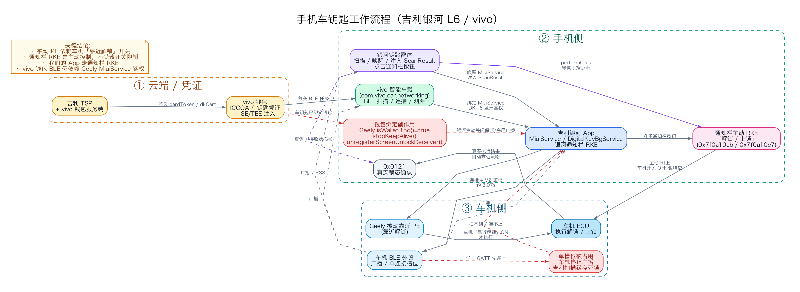
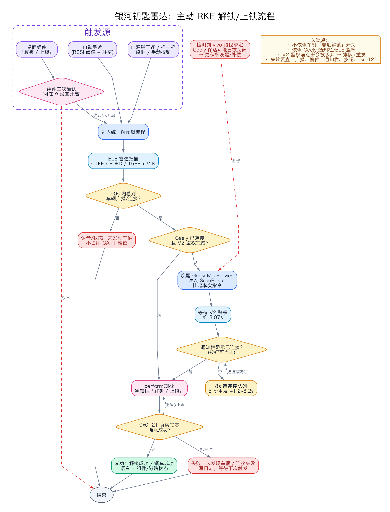
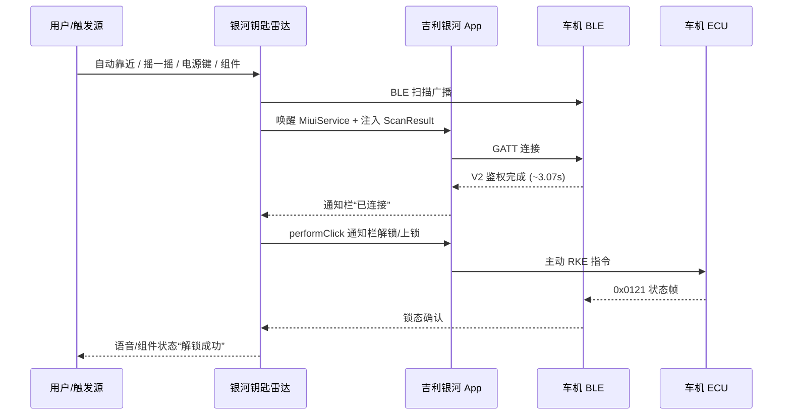

# 18. 手机车钥匙工作流程（吉利银河 L6 / vivo）

> **v4.0 说明**：当前极简版只保留“息屏靠近解锁 / 离开上锁”，车辆身份改为运行时自动学习，不再写死 VIN/MAC。本文的官方 App → MiuiService → V2 鉴权 → 通知栏 RKE 主链路仍然适用；新实现见 **[36_minimal_generic_passive_key.md](36_minimal_generic_passive_key.md)**。

本文把**银河原厂手机钥匙**和**我们 App 的主动 RKE**画成流程图，并解释“靠近不连接 / 连接不解锁”的链路原因。

> 图源（可编辑）：
> - [phone_key_workflow.dot](diagrams/phone_key_workflow.dot)
> - [our_app_rke_flow.dot](diagrams/our_app_rke_flow.dot)
>
> 渲染图：`diagrams/*.png` / `diagrams/*.svg`

---

## 一、整体工作流程



### 1. 云端/凭证

1. 吉利 TSP + vivo 钱包服务端联合签发 ICCOA 车钥匙凭证（VIN、车型、BLE MAC、`dkCert`）；
2. vivo 钱包完成卡面与 SE/TEE 密钥注入；
3. 后台 BLE 扫描/连接任务移交给 `com.vivo.car.networking`。

详见 [02_vivo_wallet_and_iccoa_key.md](02_vivo_wallet_and_iccoa_key.md#L7)。

### 2. 手机侧三条 BLE 路径

| 路径 | 扫描/连接 | 鉴权 | 解锁方式 |
| :--- | :--- | :--- | :--- |
| 银河原厂 | 银河 `ZeekrBleSdkManager` + `MiuiService` | 银河 DK1.5/V2 | 被动 PE 或通知栏 RKE |
| vivo 钱包 | `com.vivo.car.networking` 扫描/连接 | 仍绑定银河 `MiuiService` | 被动 PE（受车机开关限制） |
| 我们的 App | 雷达扫描，注入 `ScanResult` 给银河 | 银河完成 V2 | 点击通知栏 RKE |

关键：**车机 BLE 只有一个连接槽位**；任一 GATT 先连上，车机停止广播。详见 [06_real_car_field_test_and_v2_ble_findings.md](06_real_car_field_test_and_v2_ble_findings.md#L18)。

### 3. 车机侧两条解锁路径

| 路径 | 触发 | 车机“靠近解锁”开关 | 说明 |
| :--- | :--- | :--- | :--- |
| **被动 PE** | 钥匙靠近，车机判断距离 | **必须开启** | 开关关闭时车机拒绝执行 |
| **主动 RKE** | 通知栏「解锁/上锁」按钮 | **不需要** | 车机始终响应主动 RKE |

详见 [07_recent_reverse_findings_and_v2_2_features.md](07_recent_reverse_findings_and_v2_2_features.md#L36)。

### 4. 为什么我们的 App 不依赖车机开关

我们走的是：

```text
唤醒银河 MiuiService
→ 注入 ScanResult
→ 银河完成 V2 鉴权
→ 渲染银河通知栏 RemoteViews
→ performClick「解锁」
→ 0x0121 确认真实锁态
```

`performClick` 等同用户手指点击通知栏按钮，是**主动 RKE**，不受车机“靠近解锁”开关影响。  
详见 [KeyNotificationBridgeService.java](../GeelyKeyRadarApp/src/com/luca/geelykeyradar/KeyNotificationBridgeService.java#L152) 和 [07_recent_reverse_findings_and_v2_2_features.md](07_recent_reverse_findings_and_v2_2_features.md#L55)。

---

## 二、为什么“靠近不连接”

按实际发生概率：

1. **银河后台扫描缓存死锁**
   - `piScanMacCache` 在扫描失败后不清空；
   - 后续 `startBgBleScan(mac)` 直接 `return`，后台永久不再扫描；
   - 只有手动打开银河 App 点「连接蓝牙」才恢复。
   - 详见 [03_root_causes_3m_lock_and_disconnect.md](03_root_causes_3m_lock_and_disconnect.md#L30)。

2. **绑定 vivo 钱包后银河自断保活**
   - `isWalletBind()==true` → `stopKeepAlive()` + `unregisterScreenUnlockReceiver()`；
   - 银河后台 MiuiService/BLE 变弱，靠近无反应。
   - 详见 [03_root_causes_3m_lock_and_disconnect.md](03_root_causes_3m_lock_and_disconnect.md#L43)。

3. **车机单连接槽位被占**
   - vivo 车联网、银河、我们的雷达 GATT 任意一个先连上，车机停止广播；
   - 其他扫描方报 `Scan timeout`。
   - 详见 [06_real_car_field_test_and_v2_ble_findings.md](06_real_car_field_test_and_v2_ble_findings.md#L18)。

4. **OEM 息屏扫描限制**
   - OriginOS 降低后台 PendingIntent 扫描投递；
   - 没有 deviceidle/RUN_ANY_IN_BACKGROUND 豁免时，扫到也来不及鉴权。
   - 详见 [03_root_causes_3m_lock_and_disconnect.md](03_root_causes_3m_lock_and_disconnect.md#L55)。

---

## 三、为什么“连接了但不解锁”

1. **ACL 连接 ≠ V2 鉴权完成**
   - 银河 V2 鉴权约 **3.07s**；
   - 期间发出的解锁指令会被车机丢弃；
   - 早期版本 `+0s/+1.3s` 指令丢失、`+2.8s` 重发被错误门控拦截，导致“听到连接提示音但没解锁”。
   - 详见 [03_root_causes_3m_lock_and_disconnect.md](03_root_causes_3m_lock_and_disconnect.md#L107)。

2. **车机被动 PE 开关关闭**
   - 只会影响“靠近自动解锁”；
   - 不影响通知栏主动 RKE；
   - 如果我们走被动 PE，就会表现为连接了但不解锁。

3. **钱包/银河/我们抢单槽位**
   - 通知栏可能显示“已连接”，但控制通道未就绪；
   - 点击按钮无效或指令被丢弃。

4. **通知栏按钮不可点击/不存在**
   - 银河通知被系统折叠、服务被杀、未渲染成功；
   - 我们的 `performClick` 拿不到 `notif_tv_unlock`。

5. **车机安全策略拒绝**
   - 车门/挡位/钥匙在车内等条件不满足；
   - 指令已发出但 ECU 不执行。

---

## 四、我们 App 的主动 RKE 流程



关键步骤：

1. **触发**：自动靠近 / 摇一摇 / 电源键三连 / 磁贴 / 桌面组件；
2. **扫描**：`01FE / FDFD / 15FF + VIN`；
3. **判断 90s 内是否见车**：
   - 否：语音/状态“未发现车辆”，不占 GATT；
   - 是：继续；
4. **已连接且 V2 鉴权完成？**
   - 是：直接点通知栏按钮；
   - 否：唤醒 `MiuiService` + 注入 `ScanResult` + 挂起指令；
5. **等待 V2 鉴权**（约 3.07s）；
6. **通知栏已连接且按钮可点？**
   - 否：进入 8s 待连接队列，5 阶重发 `+1.2/+2.5/+3.6/+4.8/+6.2s`；
   - 是：`performClick` 通知栏「解锁/上锁」；
7. **0x0121 真实锁态确认**：
   - 成功：语音/组件/磁贴“解锁成功/锁车成功”；
   - 失败：重试/记录日志。

### 时序图



---

## 五、关于“我们自己也注册 vivo 钱包钥匙”

从现有逆向结果看，**不可行**：

- 钱包钥匙由吉利 TSP + vivo 钱包服务端联合签发，需要 `cardToken/dkCert`、SE/TEE 注入，侧载 App 无法自行签发；
- vivo 钱包的 BLE 钥匙仍要绑定银河 `MiuiService` 做 DK1.5 鉴权，没有给第三方 App 的“钥匙回调→我们决定解锁”接口；
- 车机被动 PE 仍受“靠近解锁”开关约束；要绕过只能走主动 RKE，而通知栏 RKE 已经是主动路径；
- 绑定钱包还会触发银河 `isWalletBind` 自断保活，并增加单槽位竞争，可能让连接更差。

详见 [02_vivo_wallet_and_iccoa_key.md](02_vivo_wallet_and_iccoa_key.md#L7) 与 [07_recent_reverse_findings_and_v2_2_features.md](07_recent_reverse_findings_and_v2_2_features.md#L27)。

---

## 六、排查对照表

| 现象 | 优先检查 |
| :--- | :--- |
| 靠近完全没连接 | 车机广播、单槽位、银河 `piScanMacCache`、钱包绑定后保活、OEM 息屏扫描 |
| 通知栏显示已连接但不解锁 | V2 是否满 3.07s、车机 PE 开关、按钮是否可点、是否被钱包/我们抢槽位 |
| 听到车机连接提示音但门没开 | 解锁指令是否在鉴权前发出、5 阶重发是否执行、0x0121 是否确认 |
| 我们 App 点击按钮无反应 | 通知栏是否存在、`notif_tv_unlock` 是否找到、是否执行 `performClick` |
| 车机开关关闭时银河不自动解锁 | 正常：被动 PE 被禁用；用通知栏/我们 App 主动 RKE |
