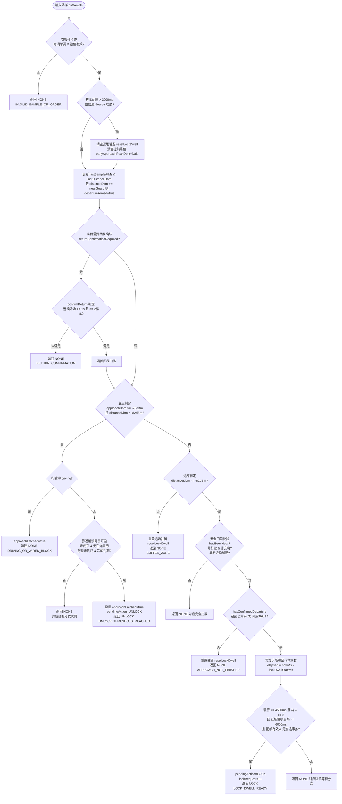
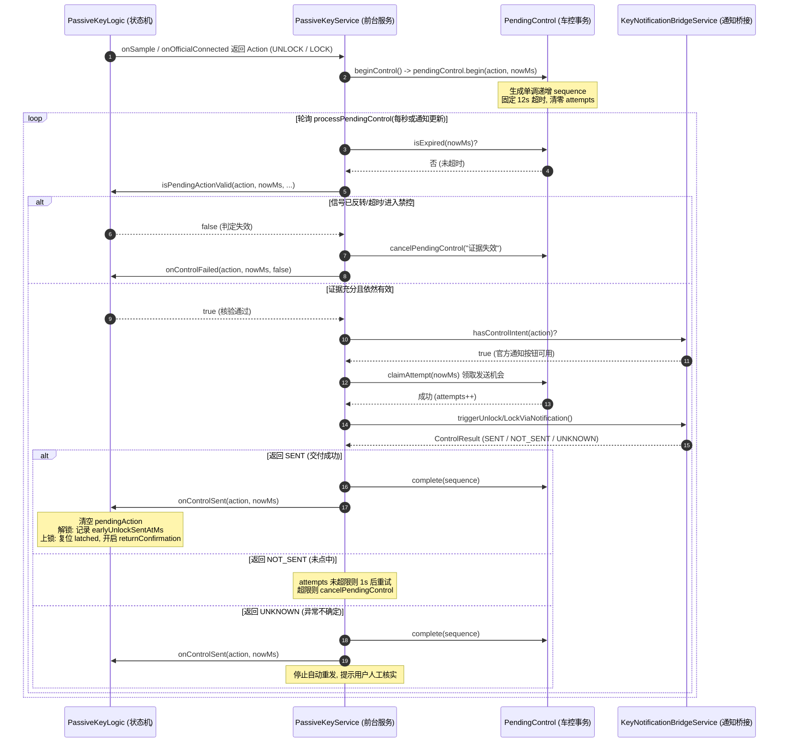

# 43. 吉利/领克极简无感钥匙：核心状态机工作过程与控制流全景技术文档

> **文档版本**：v1.0.0  
> **面向基线**：`PassiveKeyLogic.java` (682行), `PassiveKeyService.java` (2141行), `PendingControl.java` (88行), `RssiFilter.java` (106行), `KeyNotificationBridgeService.java` (998行)  
> **测试覆盖**：`PassiveKeyLogicTest.java` (36个严苛回归用例，100%覆盖通过)  
> **适用车型与生态**：吉利银河（Geely Galaxy，`com.geelygalaxy.customer`）、领克汽车（Lynk & Co，`com.lynkco.customer`）、极氪（Zeekr）等基于亿咖通（ECARX）与联合电子（UAES）SNC 平台车系。

---

## 一、概述与设计哲学

### 1.1 极简设计原则（Minimalist Design）
吉利/领克极简无感钥匙项目（GeelyPassiveKey）在经历 v1.x ~ v3.x 版本的演进后，彻底废弃了摇一摇、快捷磁贴、桌面微件、里程计算、车机 PE 参数逆向写入等边缘功能，确立了**极简无感钥匙**的核心哲学：
**系统只做且仅做两件事**：
1. **靠近解锁**：有效蓝牙信号进入近场阈值（默认 `UNLOCK_DBM = -75.0f`）$\rightarrow$ 触发一次解锁；
2. **远离上锁**：有效蓝牙信号持续处于远场阈值（默认 `LOCK_DBM = -82.0f`，连续 $\ge 4.5\text{s}$ 且 $\ge 3$ 个独立样本）$\rightarrow$ 触发一次上锁。

### 1.2 三大物理与系统硬约束及应对架构
本状态机的全部复杂性并非来自于业务规则本身，而是来自于车载蓝牙物理特性、Android 移动操作系统能耗策略以及官方 App 协议黑盒的**三大物理硬约束**：

```
+---------------------------------------------------------------------------------------------------+
|                                  吉利 / 领克 车载与系统物理约束                                    |
+------------------------------------+----------------------------------+---------------------------+
| 约束 1: 车机唯一 BLE 连接槽位       | 约束 2: AOSP 息屏扫描与后台冻结   | 约束 3: 官方通知栏无物理回执|
| (Single BLE Connection Slot)       | (Screen-Off BLE Freeze)          | (No Physical ACK for RKE) |
| 车机同时仅允许 1 个 BLE Client 连接| Android 息屏挂起无 Filter 扫描;  | PendingIntent 触发仅代表已|
| 官方 App 连接后立即停止广播;       | 系统定期深度休眠 (Doze Mode);    | 交付系统通知中心, 无法感知|
| 导致外部 App 广播 RSSI 瞬间断档。  | 缺乏持续的近场高频采样。         | 门锁机械执行状态。        |
+------------------------------------+----------------------------------+---------------------------+
                                 | 对应解决方案与状态机策略 |
                                 v                          v
+------------------------------------+----------------------------------+---------------------------+
| 解决方案:                          | 解决方案:                        | 解决方案:                 |
| 1. onOfficialConnected 槽位抢占补发| 1. 硬件 ScanFilter 息屏常驻保活  | 1. PendingControl 单一事务|
| 2. 官方就绪后共享 GATT 测距        | 2. 近场动态局部唤醒锁 (WakeLock) | 2. MAX_SEND_ATTEMPTS = 2  |
| 3. 双源隔离 (SCAN vs GATT) 独立防抖| 3. 非对称 EMA 滤波双时间常数加速 | 3. isPendingActionValid复核|
+------------------------------------+----------------------------------+---------------------------+
```

1. **车机单连接槽位约束（Single BLE Connection Slot）**
   - **物理现象**：吉利银河与领克车机蓝牙模块（UAES SNC 架构）仅分配了 1 个 BLE 连接槽位。当官方 App（`com.lynkco.customer` / `com.geelygalaxy.customer`）与车机建立连接的一瞬间，车机底层会立刻关闭广播功能（`Advertising Stop`）。
   - **次生灾害**：如果车主走向车辆时，官方 App 在 8~10 米开外抢先建立了 BLE 连接，广播信号瞬间归零。此时外部雷达若仅靠广播 RSSI 判定，将因为“广播突然消失”导致靠近解锁逻辑被饿死，造成车主在车门前罚站。
   - **应对策略**：状态机建立 `onOfficialConnected` 入口，只要官方蓝牙鉴权就绪，立刻触发一次靠近解锁；连接建立后，通过 `PassiveKeyService.ensureGattAttached` 在官方连接生命周期内共享挂载 GATT 周期性读取 `readRemoteRssi()` 作为远离测距信源。
2. **息屏省电与 AOSP 扫描冻结限制**
   - **物理现象**：自 Android 8.0 起，AOSP `ScanManager` 明确规定屏幕关闭时禁止无过滤扫描（`Cannot start unfiltered scan in screen-off`），且系统进入 Doze 状态后扫描窗口大幅衰减。
   - **应对策略**：在硬件扫描器中预埋厂商 ID（`0x01FE`）、服务 UUID（`0xFDFD`）及已学习 MAC 的硬件过滤规则；结合 `PARTIAL_WAKE_LOCK` 在靠近车辆 5 分钟内持有有限唤醒锁；滤波算法（`RssiFilter.java`）采用 350ms 的接近时间常数极速响应，消除卡尔曼双层低通造成的数秒延迟。
3. **官方通知栏车控无机械回执（No Mechanical ACK）**
   - **物理现象**：依据 `ADR-0002`，为规避私有协议逆向的法律与封号风险，本工程采用系统级通知栏桥接（`KeyNotificationBridgeService.java`），通过 `PendingIntent.send()` 触发官方按钮。此方式本质上是异步单向信发，无法像 OBD/CAN 总线那样取得门锁闭锁微动开关的物理回执。
   - **应对策略**：设计严格的事务控制机制（`PendingControl.java`），实现“固定 12 秒期限”、“单次会话至多 2 次明确未发送重试”、“发送前二次核验（`isPendingActionValid`）”及“失败 5 秒冷却惩罚”，严防指令重叠轰炸或车主走回车旁时补发误锁。

---

## 二、核心状态与内部标志位全景解析

`PassiveKeyLogic.java` 是纯 Java 实现的高内聚、无 Android Framework 依赖的严格确定性状态机（Deterministic Finite Automaton）。其内部维护了一组高敏感的标志位与时间戳，生命周期与互斥逻辑高度严密。

### 2.1 状态量速查与互斥矩阵

| 状态变量 | 类型 | 默认值 | 作用定义 | 激活（Set）条件 | 清除 / 释放条件 |
| :--- | :---: | :---: | :--- | :--- | :--- |
| `approachLatched` | `boolean` | `false` | **靠近闩锁**：标记本次接近会话是否已消耗解锁机会，杜绝车旁重复开锁 | 1. 达到解锁阈值触发解锁（L224）<br>2. 行车中进入近场（L207）<br>3. 官方蓝牙连接触发解锁（L378） | 1. `rearm()` 完全重新武装（L532）<br>2. `onControlSent(LOCK)` 锁车成功（L494）<br>3. `onControlFailed(UNLOCK)` 发送失败回滚（L520）<br>4. `reset()` 系统重置（L439） |
| `hasBeenNear` | `boolean` | `false` | **近车证据门禁**：冷启动远处静默保护；无近车证据绝不上锁 | 1. 信号进入解锁区（L200）<br>2. 官方蓝牙连接就绪（L352） | 1. `rearm()`（L533）<br>2. `onControlSent(LOCK)`（L495）<br>3. `reset()`（L440） |
| `departureArmed` | `boolean` | `false` | **离开武装标志**（v4.0.3）：确认用户已真正到达车旁近场，防提前解锁后走近误锁 | 仅当未补偿距离信号 `distanceDbm >= nearGuard`（$\ge -78\text{dBm}$）时激活（L188） | 1. `resetDepartureEvidence()`（L578）<br>2. 会话结束或重武装时清除 |
| `earlyApproachPeakDbm` | `float` | `NaN` | **提前解锁峰值记录**：记录提前解锁阶段同一信源内的测距最高值 | 处于提前解锁阶段且 `!departureArmed` 时取 `max(peak, distanceDbm)`（L191） | 1. 采样信源切换（L176）<br>2. 采样断档 >3s（L171）<br>3. 信号丢失/断开（L314, L325, L394）<br>4. 解锁交付完成（L489） |
| `lockDwellStartMs` | `long` | `0L` | **远场驻留计时起点**：连续远场计时的单调毫秒基准 | 信号首次落入远离阈值（`distanceDbm <= lockDbm`）时标记（L258） | 1. 回到缓冲带或近场（L202, L303）<br>2. 采样断档 >3s（L168, L406）<br>3. 信源切换（L177）<br>4. 链路中断或重置（L312, L323, L392） |
| `lockDwellSamples` | `int` | `0` | **远场样本积分计数**：配合驻留时长，防止单包弱信号瞬间误锁 | 处于远场阈值内每收到一条独立新鲜样本自增 1（L262） | 同 `lockDwellStartMs`，调用 `resetLockDwell()` 清零（L678） |
| `returnConfirmationRequired` | `boolean` | `false` | **回程确认门禁**：锁车后或配额耗尽后，强制要求 1 秒连续真实近场方可再解 | 1. 上锁成功送达 `onControlSent(LOCK)`（L499）<br>2. 失败配额耗尽且远场停留 >8s（L267） | 连续近场满足 $\ge 1\text{s}$ 且 $\ge 2$ 个样本（`confirmReturn` L554）；或蓝牙断开静默 12s 重新武装（L539） |
| `chargingLockBlocked` | `boolean` | `false` | **非对称充电保护**：检测到充电时封锁上锁，但放行靠近解锁 | 由服务驱动层根据电池广播状态动态设置（L81） | 拔掉充电线或离开无线充（L81） |
| `pendingAction` | `Action` | `NONE` | **在途车控互斥锁**：保证状态机与发送驱动层之间单飞单一事务 | 触发 UNLOCK（L226, L380）或 LOCK（L281）时设置为对应动作 | 1. 控制发送成功 `onControlSent`（L485）<br>2. 控制失败/取消 `onControlFailed`（L514）<br>3. `reset()`（L449） |
| `unlockRequests` | `int` | `0` | **解锁请求配额计数**：限制同一接近会话内的最大重试次数（上限 2） | 每次生成 UNLOCK 动作时自增 1（L227, L381） | 1. 实际未尝试超时的配额回滚（L518）<br>2. 近场官方重连迟到补发清零（L365）<br>3. 会话重武装 `rearm()`（L536） |
| `lockRequests` | `int` | `0` | **上锁请求配额计数**：限制同一离开会话内的最大重试次数（上限 2） | 每次生成 LOCK 动作时自增 1（L282） | 1. 实际未尝试超时的配额回滚（L524）<br>2. 回程确认成功清零（L556）<br>3. 会话重武装 `rearm()`（L537） |
| `controlRetryAfterMs` | `long` | `0L` | **失败惩罚冷却截止时间**：失败后施加 5 秒静默冷却 | 发送失败 `onControlFailed` 时置为 `nowMs + 5000L`（L515） | 1. 冷却倒计时自然到期（`nowMs >= controlRetryAfterMs`）<br>2. 近场官方重连快速恢复（L366） |

---

## 三、关键事件与状态机驱动流

状态机通过五个核心方法驱动：`onSample`、`onOfficialConnected`、`onSignalLost`、`onOfficialDisconnected` 和 `onTick`。整个判定流程遵循严格的因果时序与边界检查。

### 3.1 采样输入驱动：`onSample` 流程
`PassiveKeyLogic.java:162-306` 是系统最为核心的测距驱动链。其执行路径可划分为严格的六个阶段：



#### 核心阶段细析：
1. **时间单调性与断档清零（Lines 163-172）**：
   - 若 `nowMs <= lastSampleAtMs`（乱序或重复采样回调），立即拒绝，返回 `INVALID_SAMPLE_OR_ORDER`，防止重复计票。
   - 若采样断档时间超过 `SIGNAL_STALE_MS = 3000L`，表明蓝牙信号存在严重丢包或离开车旁，必须立刻清空驻留证据（`resetLockDwell()`），防止用户离开又回来时跨越数秒拼凑出“连续远场”。
2. **双信源隔离（Lines 173-179）**：
   - 广播扫描（`SCAN`）与 GATT 连接态（`GATT`）的射频链路与天线增益存在天然差异（实车落差可达 6~9dB）。当检测到 `source` 变化时，立刻抹去 `earlyApproachPeakDbm = Float.NaN` 并清空驻留，禁止跨源平凑数据。
3. **近场保护与离开武装（Lines 185-189）**：
   - 计算动态近场门限：`nearGuard = Math.max(lockDbm + 3.0f, Math.min(unlockDbm - 3.0f, NEAR_GUARD_DBM))`（默认计算值为 `-78.0f`）。
   - 仅当未加补偿的测距信号 `distanceDbm >= nearGuard` 时，才将 `departureArmed` 置为 `true`，并更新 `lastNearAtMs`。
4. **回程防抖确认（Lines 194-196）**：
   - 若已开启回程确认（刚锁车后），信号即便跨过 `-75dBm` 也必须先调用 `confirmReturn()`，在近场停留满 1 秒且拿到 2 个样本后才准许进入靠近判定。
5. **靠近解锁判定分支（Lines 198-229）**：
   - 准入条件：`approachDbm >= unlockDbm && distanceDbm > lockDbm`。
   - 必须同时满足 `autoUnlock` 开启、`!approachLatched`、`pendingAction == NONE`、`unlockRequests < 2`、`nowMs >= controlRetryAfterMs`，且距离上次解锁已满 8 秒冷却（`UNLOCK_COOLDOWN_MS = 8000L`）。
6. **远离上锁判定分支（Lines 231-300）**：
   - 准入条件：`distanceDbm <= lockDbm`（默认 $\le -82.0\text{dBm}$）。
   - 门禁 1：`!hasBeenNear` $\rightarrow$ 冷启动无证据拦截（`NO_NEAR_EVIDENCE`）。
   - 门禁 2：`driving || chargingLockBlocked` $\rightarrow$ 禁控拦截（`DRIVING_OR_WIRED_BLOCK`）。
   - 门禁 3：`nowMs < lockInhibitUntilMs` $\rightarrow$ 信号中断保护期拦截（`SIGNAL_LOSS_INHIBIT`）。
   - 门禁 4：`!hasConfirmedDeparture()` $\rightarrow$ 离开资格未确认（`APPROACH_NOT_FINISHED`）。
   - 触发闭锁门槛：远场驻留时间 `elapsed >= lockDwellMs`（4.5s）**且** `lockDwellSamples >= 3` **且** `(nowMs - lastNearAtMs) >= 6000L`（6秒近场保护到期）。

### 3.2 官方连接就绪事件：`onOfficialConnected`
`PassiveKeyLogic.java:341-383` 专为破解“吉利单 BLE 连接槽位”而生。

- **为什么必须具备提前解锁**：
  官方 App 抢占 BLE 槽位后，广播立即停止。此时手机端往往尚未收到 $\ge -75\text{dBm}$ 的强广播包（可能停留在 -80dBm 附近）。若无此入口，靠近流程直接死锁。
- **迟到补发机制（Late Arrival Unlock）**：
  在 v4.0.3 及测试用例 `nearOfficialConnectionTriggersLateArrivalUnlock` 中，若此前因广播阶段偶发失败导致 `unlockRequests >= 2` 配额耗尽或处于 5 秒冷却中，一旦车主真正到达车旁（`lastDistanceDbm >= unlockDbm`），官方蓝牙连接事件会执行特权豁免：
  ```java
  // PassiveKeyLogic.java:364-367
  if (autoUnlock && !driving && lastDistanceDbm >= unlockDbm) {
      unlockRequests = 0;
      controlRetryAfterMs = 0L;
  }
  ```
  清零请求配额并重置冷却，立即触发 `OFFICIAL_READY_UNLOCK`，实现“车旁连接即刻补开门”，彻底根除罚站！
- **远距拦截保护**：
  若官方在极远处建立连接，但手机恰好在 3 秒内收到过强力远场信号（`lastDistanceDbm <= lockDbm`），则触发 `FRESH_FAR_SIGNAL` 拦截，杜绝车主刚走出蓝牙边缘时由于车机重连发生“反向解锁开门”。

### 3.3 物理/蓝牙断连与异常处理
- **`onSignalLost(nowMs)` (L311-317)**：
  当 GATT 测距停更（超过 6 秒无样本）或 BLE 扫描异常中断时调用。立即清空驻留 `resetLockDwell()`、清空回程确认、失效提前峰值，并强制进入 10 秒禁锁期（`lockInhibitUntilMs = nowMs + 10000L`）。
- **`onBluetoothReset(nowMs)` (L322-328)**：
  当用户在系统控制中心重启蓝牙，或系统蓝牙堆栈崩溃自愈时调用。施加长达 15 秒的上锁禁令，严禁把“蓝牙射频关闭导致的信号消失”判定为“车主走远上锁”。
- **`onOfficialDisconnected(nowMs)` (L388-395)**：
  官方蓝牙断开时调用。记录断开时刻 `officialDisconnectedAtMs`，重置所有驻留计时，为后续无感重新武装提供基准。

### 3.4 周期性心跳与自愈维护：`onTick`
`PassiveKeyLogic.java:404-433` 由主服务 Handler 以 500ms 周期稳定调用。

- **解决核心痛点**：
  车主离开车辆走出 15~20 米后，手机往往直接断开且**彻底收不到任何 BLE 样本**（自然静默），而不是持续收到 `-85dBm` 的样本。此时不会再有 `onSample` 驱动状态机。
- **无感自愈与重新武装（Rearm）**：
  当满足以下三大条件时，`onTick` 判定本次出行会话已彻底结束：
  1. `noRecentNearSignal`：最近无近车证据已持续满 12 秒（`REARM_DISCONNECTED_SILENCE_MS = 12000L`）；
  2. `disconnectedLongEnough || signalGoneLongEnough`：官方断开满 8 秒或射频信号彻底消失满 12 秒；
  3. 非行驶中且无在途事务。
  一旦满足，立即执行 `rearm()`，将 `approachLatched`、`hasBeenNear`、配额与防抖门禁全部复位，返回 `true`，神不知鬼不觉地为下一次靠近重新武装！

### 3.5 控制事务生命周期与二次校验
车控执行遵循“准备 $\rightarrow$ 校验 $\rightarrow$ 派发 $\rightarrow$ 反馈”的严格闭环：



- **发送前复核 `isPendingActionValid` (L466-479)**：
  在点击通知栏按钮的最后一微秒，必须通过此闸门：
  * 若为 UNLOCK：核验是否仍开启自动解锁，且未在最近 3 秒内收到远场信号（防止跑向远处时补开门）。
  * 若为 LOCK：必须确认非充电、已离开近场（`hasConfirmedDeparture()`）、最近样本在 3 秒以内且 $\le -82\text{dBm}$、连续样本数 $\ge 3$、驻留时长 $\ge 4.5\text{s}$ 且近场保护离场时间 $\ge 6\text{s}$。任何一条不满足，上锁请求当场作废！

---

## 四、严密的安全防护与边界机制（以一手代码与用例溯源）

### 4.1 冷启动远处静默（无近车证据绝不上锁）
- **物理风险**：用户在室内启动 App，此时车停在楼下，手机收到 `-90dBm` 极其微弱的偶发蓝牙广播。若无冷启动保护，状态机将误以为车主刚刚离开车辆，反复向官方 App 发送上锁指令扰民耗电。
- **代码实现**：`PassiveKeyLogic.java:233-236`
  ```java
  if (!hasBeenNear) {
      resetLockDwell();
      return sampleDecision(Action.NONE, "NO_NEAR_EVIDENCE", nowMs);
  }
  ```
- **测试溯源**：`PassiveKeyLogicTest.java:75-81` (`coldStartWeakSignalNeverLocks`)。注入 30 个连续 `-90dBm` 远场样本，状态机坚决返回 `NONE`，绝不补发上锁。

### 4.2 六秒座舱近场保护（防多径深衰落误锁）
- **物理风险**：车主坐进车内关上车门，人体与金属车体形成严重电磁屏蔽与多径干涉，导致座舱内信号产生高达 20dB 的瞬时深衰落（骤降至 `-85dBm` 以下）。如果按 4.5 秒驻留直接锁车，车主将被反锁在车内。
- **代码实现**：`PassiveKeyLogic.java:28-31, 280`
  ```java
  static final long NEAR_GUARD_MS = 6000L;
  static final float NEAR_GUARD_DBM = -78.0f;
  // ...
  && (lastNearAtMs == 0L || (nowMs - lastNearAtMs) >= NEAR_GUARD_MS)
  ```
- **架构创新**：近场保护计时与远场驻留计时**并行推进**（测试用例 `nearGuardAndDwellRunTogether` L191-199）。在人离开车旁的第 6 秒，近场保护与 4.5 秒远场驻留同时满足，立刻触发上锁，绝不串行拖延至 10.5 秒。
- **测试溯源**：`PassiveKeyLogicTest.java:159-171` (`nearGuardAvoidsCabinFalseLock`)。在近场解锁后，注入 5 秒的车内 `-85dBm` 衰落信号，近场保护全程拦截误锁。

### 4.3 提前解锁后持续靠近的防反向上锁（v4.0.3 核心修复）
- **物理风险**（详见 `docs/40_v4_0_3_approach_relock_guard.md`）：在 8 米处官方蓝牙连接触发提前解锁，此时用户以正常步速继续走向车门。在此期间，手机收到 `-89dBm \rightarrow -83dBm` 的信号。虽然信号在递增，但绝对值仍弱于 `-82dBm`。旧版因官方连接粗暴激活了近场证据，在 6 秒保护到期的一刹那，将正在靠近的用户当成离开，当面反向锁车！
- **代码实现**：引入 `departureArmed` 与峰值 6dB 差分机制（`PassiveKeyLogic.java:39, 72, 186-193, 249-253, 571-574`）
  ```java
  static final float EARLY_DEPARTURE_DROP_DBM = 6.0f;
  // 必须进入真实车旁（>=-78dBm）或者同源信号比峰值衰减 6dB
  private boolean hasConfirmedDeparture() {
      return departureArmed || (earlyUnlockSentAtMs > 0L && Float.isFinite(earlyApproachPeakDbm)
              && earlyApproachPeakDbm - lastDistanceDbm >= EARLY_DEPARTURE_DROP_DBM);
  }
  ```
- **测试溯源**：
  * `PassiveKeyLogicTest.java:444-464` (`earlyOfficialUnlockDoesNotLockWhileApproaching`)：完全回放实车 13 帧递增弱信号，坚决不上锁，直到真正进入车旁后再离开方才上锁。
  * `PassiveKeyLogicTest.java:467-475` (`remainingAtEarlyUnlockDistanceDoesNotLock`)：在 8 米提前解锁处原地停留 30 秒，不发错误 LOCK。
  * `PassiveKeyLogicTest.java:478-495` (`abortedEarlyApproachStillLocksAfterRealWeakening`)：提前解锁后未到车旁便转身离开，信号衰减 6dB 后依然能可靠锁车，绝不留下未锁车辆。

### 4.4 非对称充电保护（ADR-0003）
- **物理风险**：领克 08/07/10 EM-P 配备 50W 车载无线快充面板。若采用对称禁控，车主在车外随身携带无线充电宝走向车辆时，靠近解锁将被完全封杀；若不做禁控，手机放无线充上行车颠簸时会被误锁。
- **代码实现**：`PassiveKeyLogic.java:79-87, 238-242` 与 `KeyNotificationBridgeService.java:242-272`
  ```java
  // 解锁操作永远不受充电拦截；上锁操作在充电时被绝对封杀
  if (unlock) {
      return false;
  }
  ```
- **测试溯源**：`PassiveKeyLogicTest.java:549-568` (`asymmetricChargingInhibitAllowsUnlockBlocksLock`)。验证了带充电宝靠近解锁秒开，而在车内充电弱信号深衰落时绝对禁锁。

### 4.5 锁后回程防抖与边界防震荡
- **物理风险**：锁车刚刚完成，车主刚走出 8 米停步，钥匙在口袋中微弱晃动，信号在 `-81dBm` 与 `-83dBm` 之间来回跳变。此时口袋补偿（+8dB）若被激活，可能将 `-81dBm` 放大为 `-73dBm`，瞬间反向解锁，造成门锁“上锁-解锁-上锁”疯狂打架。
- **代码实现**：`PassiveKeyLogic.java:38, 63-65, 499, 546-562`
  ```java
  static final long RETURN_NEAR_CONFIRM_MS = 1000L;
  // 锁后强制置位 returnConfirmationRequired = true
  // confirmReturn 要求未补偿信号真实达到 nearGuard 维持 1 秒且至少 2 帧
  ```
- **测试溯源**：`PassiveKeyLogicTest.java:325-344` (`pocketJitterAfterLockDoesNotUnlockAgain`)。在锁后注入 40 帧边界抖动包（-81/-83dBm），系统纹丝不动；只有当真实 `-75dBm` 连续出现 1.5 秒后才放行新一轮解锁。

### 4.6 车控请求配额、冷却惩罚与超时自愈
- **物理风险**：当官方 App 进程假死或蓝牙连接卡在半握手状态时，无限制的重试会导致车控队列无限膨胀，严重消耗手机电量并阻塞后续逻辑。
- **配额规则**：
  * 限制同一动作每次会话最多尝试 2 次请求（`MAX_REQUESTS_PER_ACTION = 2`）；
  * 每次明确失败后施加 5 秒惩罚冷却（`CONTROL_FAILURE_COOLDOWN_MS = 5000L`）；
  * **防误杀回滚**：若请求是在 `PendingControl` 队列中因等待官方就绪超时（12秒未实际调用 `send()`），则调用 `onControlFailed(action, nowMs, false)`，不扣减解锁配额（`actuallyAttempted == false`），冷却后依然保留重试权利！
- **测试溯源**：
  * `PassiveKeyLogicTest.java:571-587` (`unattemptedTimeoutDoesNotExhaustUnlockQuota`)：两次未尝试超时绝不耗尽配额。
  * `PassiveKeyLogicTest.java:633-648` (`actualAttemptFailureConsumesQuota`)：实发失败严格扣除配额，两次失败后锁定，直至离开重置。

---

## 五、单元测试与实车场景映射全景表

`GeelyKeyRadarApp/tests/com/luca/geelykeyradar/PassiveKeyLogicTest.java` 包含了 36 个高强度的严苛单测。这些单测全部映射自真实车主踩坑、实车路测与日志抓取的典型故障场景：

| 序号 | 单元测试方法名 (`PassiveKeyLogicTest.java`) | 核心断言与输入序列 | 映射的实车故障场景 / 解决的技术隐患 |
| :---: | :--- | :--- | :--- |
| 1 | `unlockOnlyOncePerApproach` (L47) | 连续输入强信号 `-60dBm`，首帧返回 `UNLOCK`，后续持续为 `NONE` | 车主在车旁停留装行李或聊天时，门锁反复咔嗒解锁耗电 |
| 2 | `awayLockNeedsDwellAndSamples` (L59) | 解锁后输入 `-84dBm`，第1/2帧均不锁，满 4.5s 且 $\ge 3$ 样本时返回 `LOCK` | 解决因单帧射频跳水直接误锁的恶性问题 |
| 3 | `coldStartWeakSignalNeverLocks` (L75) | 未接近过车辆时，连续 30 帧输入 `-90dBm` 恒为 `NONE` | App 冷启动或后台拉起时，对远在停车场的车辆凭空补发上锁 |
| 4 | `signalLossDoesNotLock` (L84) | 解锁后调用 `onSignalLost`，随后 10 帧 `-90dBm` 恒为 `NONE` | 地库金属屏蔽导致蓝牙物理断开时，App 误把断链当成人走远锁车 |
| 5 | `drivingDoesNotSendUnlock` (L97) | 行驶中输入 `-55dBm` 极强信号，拦截解锁，但记录 `approachLatched` | 行车途中由于蓝牙钥匙连接变化在车机内疯狂弹窗开锁 |
| 6 | `rearmAllowsNextApproachUnlock` (L107) | 关自动上锁时，持续远场 8s 重武装，下次靠近重新解锁 | 适配仅开启“靠近解锁”单项开关用户的完整使用闭环 |
| 7 | `drivingBlocksLockAndRearmUntilParked` (L121) | 行驶中持续弱信号恒不锁，停车切为 `P档` 远场后恢复正常上锁 | 高架或高速行驶经过隧道弱信号时，车门自动落锁触发系统报警 |
| 8 | `middleZoneCancelsLockDwell` (L143) | 远场计时中途回到 `-70dBm` 安全缓冲带，驻留计时清零重算 | 车主在远离边界由于拿快递折返，导致上锁计时跨时段累计误锁 |
| 9 | `nearGuardAvoidsCabinFalseLock` (L159) | 车内 `-60dBm` 突发 5 秒 `-85dBm` 深衰落，近场保护全程拦截 | 车主坐进车内关门瞬间，由于座舱屏蔽车门被反向锁死 |
| 10 | `officialConnectedFiresUnlockAndSilenceRearms` (L174) | 官方抢占槽位触发解锁；断开无信号满 12s 后自动重武装 | 攻克吉利车机单连接槽位广播消失难题，实现走出蓝牙后无感自愈 |
| 11 | `nearGuardAndDwellRunTogether` (L191) | 6秒近场保护与 4.5秒远场驻留并行计算，在第 6 秒准时锁车 | 根除旧版 6s + 4.5s 串行累加导致的 10.5 秒漫长等待（“离开罚站”） |
| 12 | `sampleGapRestartsDwell` (L202) | 远场样本间隔超过 30 秒（断档），第三个样本不准上锁，重新计时 | 手机被系统休眠挂起 30 秒后苏醒，拿 30 秒前的旧样本拼凑上锁 |
| 13 | `duplicateSampleDoesNotCount` (L215) | 同一时间戳注入 20 次回调，有效样本计数依然为 1 | Android 系统回调抖动或并发派发导致的虚假多样本误判 |
| 14 | `pocketCompensationDoesNotPostponeLock` (L225) | 接近值 `-77dBm`（+8dB），距离值 `-85dBm`，按距离值准时上锁 | 解锁口袋补偿错误作用于上锁判定，导致放在裤兜里迟迟不锁车 |
| 15 | `failedLockRetainsSessionAndRetryIsBounded` (L235) | 上锁失败后保留会话，冷却 5s 后允许补发一次，总上限 2 次 | 官方 App 瞬间卡顿导致上锁失败后放弃锁车，或疯狂重发轰炸 |
| 16 | `pendingLockCancelledByReturnOrSignalLoss` (L261) | 等待发送时信号变强、超时或蓝牙重启，`isPendingActionValid` 判无效 | 车主走远触发上锁，但在发送队列排队期间车主跑回车旁依然被锁 |
| 17 | `pendingUnlockRespectsAllSwitches` (L277) | 解锁等待就绪期间，若插线、行驶、关开关或走远，立即撤销发送 | 鉴权延迟 3 秒期间车况发生突变（如直接挂挡行驶），旧开锁依然生效 |
| 18 | `lateOfficialConnectionDoesNotCreateAnotherAction` (L292) | 距离已产生 UNLOCK，迟到的官方连接仅完成已有事务，不产新动作 | 射频广播与官方连接先后就绪时，连续向车机派发两次解锁撞车 |
| 19 | `failedUnlockRearmsAfterLeaving` (L308) | 解锁失败耗尽配额，断连离开满 12s 后重置，下次接近满血复活 | 解锁偶发失败后用户离开，下次再来车机由于配额锁死彻底瘫痪 |
| 20 | `pocketJitterAfterLockDoesNotUnlockAgain` (L325) | 锁后在 `-81/-83dBm` 边界抖动 40 帧不触发解锁，真近场 1s 才解 | 锁车后在车尾 5 米处系鞋带，车门在背后反复解锁上锁跳变 |
| 21 | `staleFarSignalDoesNotBlockOfficialConnection` (L347) | 超过 3 秒前的过期远场弱信号，不拦截新的官方连接就绪解锁 | 之前地库残留的旧弱信号卡死后续正常靠近的官方秒开链路 |
| 22 | `failedUnlockBudgetRecoversAfterReturnWhileConnected` (L358) | 官方始终保持连接（如蓝牙未断），离开后再回近场自动恢复配额 | 官方 BLE 未断连场景下失败配额无法自愈的死锁故障 |
| 23 | `failedLockBudgetRecoversAfterReturnWhileConnected` (L375) | 站在远处不上锁，回到近场后再离开，获得新的上锁配额 | 车主一直在远距边界徘徊导致上锁耗尽配额后，再次离开不锁车 |
| 24 | `completedDepartureRearmsNewOfficialApproach` (L394) | 离开断连满 12s 彻底结束旧会话，下一次官方先连接仍可秒开 | 上一轮的防抖与回程确认错误污染下一轮全新的出行会话 |
| 25 | `freshFarReconnectAfterRearmStaysLocked` (L405) | 已重武装但 3s 内有新鲜远场 `-83dBm`，官方重连坚决不开锁 | 远离后官方蓝牙在 10 米外因多径反射抽搐重连，导致隔空误开锁 |
| 26 | `wiredSessionLocksAfterUnplugAndDeparture` (L418) | 车内插线只占接近不发开锁，停车拔线后靠新弱信号正常上锁 | 手机连 CarPlay/HiCar 插线充电下车后，车辆无法自动远离上锁 |
| 27 | `signalLossRestartsReturnConfirmation` (L431) | 锁后回程确认中途蓝牙断开，重新连接后必须从零重新计时 1 秒 | 断链瞬间利用断档前的时间跨度非法跳过回程 1 秒近场要求 |
| 28 | `earlyOfficialUnlockDoesNotLockWhileApproaching` (L444) | 8米提前开锁后输入 13 帧持续增强弱信号，绝对不上锁（v4.0.3） | **彻底消灭 2026-11-07 实车最大痛点：迎面走近车辆中途反向上锁** |
| 29 | `remainingAtEarlyUnlockDistanceDoesNotLock` (L467) | 提前解锁后在 8 米处站立停留 30 秒，6秒近场保护到期不锁车 | 车主走近车辆在 8 米处接电话停留，车辆突然当面落锁 |
| 30 | `abortedEarlyApproachStillLocksAfterRealWeakening` (L478) | 提前解锁后转身离开，同源下降 6dB 且驻留 4.5s 后安全锁车 | 车主走近触发开锁后突然改变主意转身离开，导致车辆常开丢车 |
| 31 | `switchingRssiSourceDoesNotPretendDeparture` (L498) | SCAN 广播 `-80dBm` 切换到 GATT 连接态 `-89dBm`，不视为离开 | 广播切连接态天线落差 9dB，被系统当作“车主瞬间跑远”直接误锁 |
| 32 | `sourceSwitchRestartsContinuousFarDwell` (L513) | GATT 驻留未满切到 SCAN，旧驻留立即失效，新通道重新确认 4.5s | 两个信源各自的残存时间拼接出虚假的 4.5 秒远场误锁 |
| 33 | `asymmetricChargingInhibitAllowsUnlockBlocksLock` (L549) | 充电中放行靠近解锁（防带充电宝罚站），彻底封死自动上锁 | 规避无线充电宝罚站，同时杜绝车载无线充行车颠簸时落锁 |
| 34 | `unattemptedTimeoutDoesNotExhaustUnlockQuota` (L571) | 队列中因等待官方超时未发，配额回滚，冷却后允许再次解锁 | 官方 App 冷启动过慢导致超时，直接吃掉用户唯二解锁机会使之瘫痪 |
| 35 | `nearOfficialConnectionTriggersLateArrivalUnlock` (L590) | 配额已耗尽，但人在车旁（$\ge -75\text{dBm}$）官方连接成功，迟到补发解锁 | 射频极差时车主已到车门，官方连上的一瞬间立即复活开锁 |
| 36 | `actualAttemptFailureConsumesQuota` (L633) | 实际调用 `send()` 但返回失败，扣除配额，两次后坚决锁死冷却 | 通知系统报错时无限制死循环疯狂点击，引发系统 ANR 与电量雪崩 |

---

## 六、全生命周期核心状态转移图（State Diagram）

本状态机的全局状态迁移由输入事件（`onSample` / `onOfficialConnected` / `onTick` / `onControlSent` 等）精确驱动：

```mermaid
stateDiagram-v2
    [*] --> IDLE : 冷启动 / 系统重置 (reset)

    state IDLE {
        [*] --> COLD_FAR : hasBeenNear=false\napproachLatched=false
        note right of COLD_FAR
            冷启动远处静默:
            任何远场弱信号均返回 NO_NEAR_EVIDENCE
            绝不上锁
        end note
    }

    IDLE --> APPROACHING : 采到近场信号 (approachDbm >= -75dBm)
    IDLE --> OFFICIAL_CONNECTING : 官方蓝牙连接就绪 (onOfficialConnected)

    state OFFICIAL_CONNECTING {
        [*] --> CHECK_FAR
        CHECK_FAR --> OFFICIAL_UNLOCKED : lastDistanceDbm > -82dBm\n(触发迟到补发/提前解锁)
        CHECK_FAR --> IDLE : lastDistanceDbm <= -82dBm (新鲜远场拦截)
    }

    state APPROACHING {
        [*] --> UNLOCK_DISPATCH
        UNLOCK_DISPATCH --> UNLOCK_WAIT_ACK : beginControl(UNLOCK)\npendingAction=UNLOCK
    }

    OFFICIAL_CONNECTING --> UNLOCK_WAIT_ACK : 派发提前开锁

    state UNLOCK_WAIT_ACK {
        [*] --> SENDING
        SENDING --> UNLOCKED_EARLY_PHASE : onControlSent(UNLOCK)\nearlyUnlockSentAtMs=now\ndepartureArmed=false
        SENDING --> IDLE : onControlFailed(超时且未尝试, 回滚配额)
        SENDING --> COOLDOWN_RETRY : onControlFailed(实发失败, 冷却5s)
    }

    state UNLOCKED_EARLY_PHASE {
        note left of UNLOCKED_EARLY_PHASE
            v4.0.3 提前解锁阶段:
            1. 正在走近 (弱信号增强) -> 拦截上锁
            2. 原地停留 (无6dB下降) -> 拦截上锁
            3. 真正到达车旁 (>= -78dBm) -> departureArmed=true
            4. 转身离开 (同源下降>=6dB) -> 允许确认离开
        end note
        [*] --> WALKING_CLOSER
        WALKING_CLOSER --> AT_VEHICLE : distanceDbm >= -78dBm\ndepartureArmed=true
        WALKING_CLOSER --> TURN_AROUND : earlyPeak - distanceDbm >= 6dB
    }

    state AT_VEHICLE {
        [*] --> VEHICLE_PRESENCE : approachLatched=true\nhasBeenNear=true
        note right of AT_VEHICLE
            车旁/车内安全区:
            6秒近场保护生效
            车内深衰落被 nearGuard 拦截
        end note
    }

    AT_VEHICLE --> DEPARTING_DWELL : 离开近场且 distanceDbm <= -82dBm
    TURN_AROUND --> DEPARTING_DWELL : 转身离开且 distanceDbm <= -82dBm

    state DEPARTING_DWELL {
        [*] --> DWELL_ACCUMULATING : 记录 lockDwellStartMs
        note right of DWELL_ACCUMULATING
            双重判定门限:
            1. 远场时长 >= 4500ms
            2. 独立样本 >= 3 个
            3. 距最近近场 >= 6000ms
        end note
        DWELL_ACCUMULATING --> DWELL_READY : 条件全满
        DWELL_ACCUMULATING --> AT_VEHICLE : 中途回到安全区 (resetLockDwell)
        DWELL_ACCUMULATING --> [*] : 信号中断 (onSignalLost 禁锁10s)
    }

    DEPARTING_DWELL --> LOCK_DISPATCH : DWELL_READY 触发上锁

    state LOCK_DISPATCH {
        [*] --> LOCK_SENDING : beginControl(LOCK)\npendingAction=LOCK
        LOCK_SENDING --> LOCKED_WAIT_RETURN : onControlSent(LOCK)\nreturnConfirmationRequired=true\napproachLatched=false\nhasBeenNear=false
        LOCK_SENDING --> AT_VEHICLE : isPendingActionValid=false (走回车旁取消)
    }

    state LOCKED_WAIT_RETURN {
        note right of LOCKED_WAIT_RETURN
            回程确认安全防线:
            边界抖动 (-81/-83dBm) 恒封锁
            必须未补偿信号 >= -78dBm 持续 1 秒
        end note
        [*] --> RETURN_FILTERING
        RETURN_FILTERING --> APPROACHING : confirmReturn 成功 (连续1s近场)
        RETURN_FILTERING --> IDLE : 走出蓝牙范围且断链满 12s (onTick 自愈)
    }
```

---

## 七、源码核心符号与行号对照索引

为方便后续代码审计与工程对标，核心符号与源码位置映射如下：

| 模块文件 | 符号名称 | 类型 | 行号区间 | 核心功能与逻辑说明 |
| :--- | :--- | :---: | :---: | :--- |
| **`PassiveKeyLogic.java`** | `UNLOCK_DBM` / `LOCK_DBM` | 常量 | L26-27 | 默认靠近解锁（`-75dBm`）与远离上锁（`-82dBm`）门限 |
| | `NEAR_GUARD_MS` / `NEAR_GUARD_DBM` | 常量 | L29, L31 | 座舱 6 秒近场保护窗口与 `-78dBm` 门限 |
| | `EARLY_DEPARTURE_DROP_DBM` | 常量 | L39 | 提前解锁后转身离开的 6dB 差分下降门限（v4.0.3） |
| | `MAX_REQUESTS_PER_ACTION` | 常量 | L40 | 每个动作单次会话上限 2 次尝试 |
| | `onSample(...)` | 方法 | L162-306 | 核心采样判定，涵盖时间单调、断档、信源切换、双分支决策 |
| | `onOfficialConnected(...)` | 方法 | L341-383 | 官方蓝牙连接就绪处理，槽位抢占补发与迟到补发特权入口 |
| | `onTick(...)` | 方法 | L404-433 | 周期性 500ms 巡检，断开静默 12 秒自愈重新武装 |
| | `isPendingActionValid(...)` | 方法 | L466-479 | 车控发送前最后一微秒复核，方向反转或证据失效撤销 |
| | `onControlSent(...)` | 方法 | L482-503 | 控制交付成功反馈，重置在途锁，激活提前开锁期或回程门禁 |
| | `onControlFailed(...)` | 方法 | L506-528 | 控制失败反馈，施加 5s 惩罚冷却，支持未尝试超时的配额回滚 |
| | `hasConfirmedDeparture()` | 私有方法 | L571-574 | 离开资格核验（`departureArmed` 或同源降 6dB） |
| | `confirmReturn(...)` | 私有方法 | L546-562 | 锁后回程确认，要求未补偿信号 $\ge -78\text{dBm}$ 维持 1 秒且 $\ge 2$ 帧 |
| **`PendingControl.java`** | `TIMEOUT_MS` / `MAX_SEND_ATTEMPTS` | 常量 | L5, L7 | 事务固定 12 秒超时，单事务最大尝试 2 次 |
| | `begin(...)` / `claimAttempt(...)` | 方法 | L17, L53 | 创建事务、单调递增 sequence、按秒节流领取发送机会 |
| | `complete(...)` / `cancel()` | 方法 | L69, L76 | 事务原子完成与版本号作废取消 |
| **`RssiFilter.java`** | `APPROACH_TIME_CONSTANT_MS` | 常量 | L15 | 接近时间常数 350ms，实现息屏走近急速收敛 |
| | `DEPARTURE_TIME_CONSTANT_MS` | 常量 | L16 | 远离时间常数 750ms，滤波兼顾平滑抗抖 |
| | `median()` | 私有方法 | L95-105 | 三点中值滤波，抑制单包强弱野值脉冲 |
| **`KeyNotificationBridgeService.java`** | `fireNotificationButton(...)` | 方法 | L292-329 | 提取 `PendingIntent` 或调用 `RemoteViews` 反射点击触发官方车控 |
| | `isControlBlocked(...)` | 方法 | L242-272 | 非对称充电保护逻辑，放行解锁，封死上锁 |

---

## 八、总结与架构启示

吉利/领克极简无感钥匙状态机之所以能在复杂严苛的车载无线电与 Android 碎片化 ROM 中稳定运行，其根本原因在于：

1. **对物理约束的深刻尊重**：不盲目追求虚幻的“多点高阶卡尔曼定位”，而是针对“车机单连接槽位”、“车内多径衰落”、“息屏扫描挂起”和“通知栏无回执”四大现实物理边界量身定制对策；
2. **非对称设计思想**：
   - **信号补偿非对称**：接近允许加 8dB 口袋补偿以提高开门灵敏度；离开测距与近场保护严格使用真实滤波值，确保上锁绝不延误。
   - **充电保护非对称**：充电中放行靠近解锁（避免随身充电宝罚站），拦截远离上锁（避免行车与无线充误锁）。
   - **时间常数非对称**：接近滤波 350ms 快速响应，远离滤波 750ms 沉稳抗抖。
3. **基于确定性有限状态机（DFA）的自愈防御**：全状态闭环，不留未定义的悬空状态，配合 36 个全覆盖测试用例构筑了极高的工程质量底线。所有时间戳、配额与标记均支持超时自愈与断连重武装，确保在任何极端车况与无线电扰动下，系统永不死锁。
